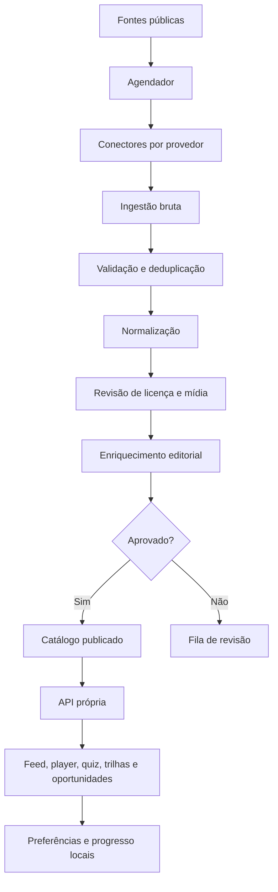

# Arquitetura de APIs e pipeline editorial

## Objetivo

Transformar dados públicos em conteúdo confiável, contextualizado e rápido de entregar. O aplicativo não consulta APIs de terceiros durante a rolagem do feed. As fontes são consultadas por conectores no backend, com cache, validação e atualização controlada.

## Fluxo

## Responsabilidades

### Registro de fontes

Manter por provedor: nome, documentação, endpoints usados, cobertura, autenticação, limites, licença/termos, atribuição exigida e data da última revisão.

### Conectores

Cada fonte tem adaptador isolado. Contrato conceitual:

- `discoverUpdates()`: identifica novos registros.
- `fetchRecord(id)`: busca registro original.
- `normalize(raw)`: converte para o modelo interno.
- `validate(item)`: valida campos e integridade.
- `checkRights(item)`: identifica licença e política de uso.
- `getAttribution(item)`: gera crédito e URL de origem.

A API do aplicativo não deve conhecer o formato particular de NASA, ENEM, OpenAlex ou GBIF.

### Ingestão, validação e normalização

Persistir ID externo, resposta original ou referência, hash do payload, versão do conector e data de captura. Padronizar datas, idioma, categorias, identificadores e URLs. Não inventar campos ausentes. Campos criados editorialmente precisam ser identificados como tais.

### Direitos e qualidade

A existência de uma URL pública não autoriza automaticamente a cópia ou redistribuição do conteúdo. Registrar licença e atribuição de cada imagem, vídeo, áudio, texto ou questão. Itens com direitos não esclarecidos ficam em `needs_rights_review` e não são publicados como mídia.

### Enriquecimento editorial

GPT pode auxiliar na preparação de ganchos, explicações, roteiros, perguntas e relações com profissões. Não publica automaticamente. A informação factual deve ser conferida contra a fonte original e revisada antes de ir ao catálogo.

### Estados editoriais

`discovered` → `ingested` → `validated` → `editorial_review` → `approved` → `published`.

Estados alternativos: `rejected`, `needs_rights_review`, `stale` e `source_unavailable`.

## Modelo de dados inicial

| Entidade | Finalidade |
|---|---|
| `source_registry` | Documentação, licença, cobertura e limites de cada fonte |
| `external_records` | Payload bruto, ID externo, hash e data de captura |
| `content_items` | Conteúdo editorial publicado |
| `content_assets` | Imagens, vídeos, áudio, legenda, transcrição e direitos |
| `content_relations` | Relações entre assuntos e conteúdos |
| `editorial_reviews` | Status, aprovação e observações |
| `enem_questions` | Questões importadas e validação |
| `quiz_explanations` | Explicações editoriais revisadas |
| `learning_paths` | Trilhas de aprofundamento |
| `opportunities` | Cursos, instituições e oportunidades verificadas |

O progresso guest permanece no dispositivo no primeiro MVP. O catálogo público é armazenado no backend.

## API interna proposta

- `GET /api/v1/feed?cursor=...`: página de feed, com cursor.
- `GET /api/v1/content/:slug`: detalhe, assets, fontes e próximos passos.
- `GET /api/v1/tracks/:slug`: trilha de aprofundamento.
- `GET /api/v1/opportunities?topic=...`: oportunidades verificadas.
- `GET /api/v1/quizzes/enem/daily?area=...`: sessão curta sem gabarito.
- `POST /api/v1/quizzes/enem/:questionId/answer`: valida resposta e retorna feedback.

Essas rotas são especificação, não endpoints implementados nesta entrega. O cliente chama somente a API própria; segredos e conectores ficam no backend.

## Resiliência

- Atualização em cron, não por usuário.
- Rate limit respeitado por fonte.
- Timeout, retry com backoff e circuit breaker.
- Cache persistente dos registros normalizados.
- Deduplicação por fonte, ID externo e hash.
- O último conteúdo aprovado permanece disponível durante indisponibilidade da fonte.
- Monitorar falhas e itens pendentes de revisão.

## Guest-first

Preferências, favoritos, sessões e progresso ficam no IndexedDB. Não enviar histórico de consumo ao backend no primeiro MVP. A personalização ocorre no cliente com interesses explícitos, salvamentos e desafios concluídos. O feed combina familiaridade, assuntos relacionados e descobertas inesperadas.
